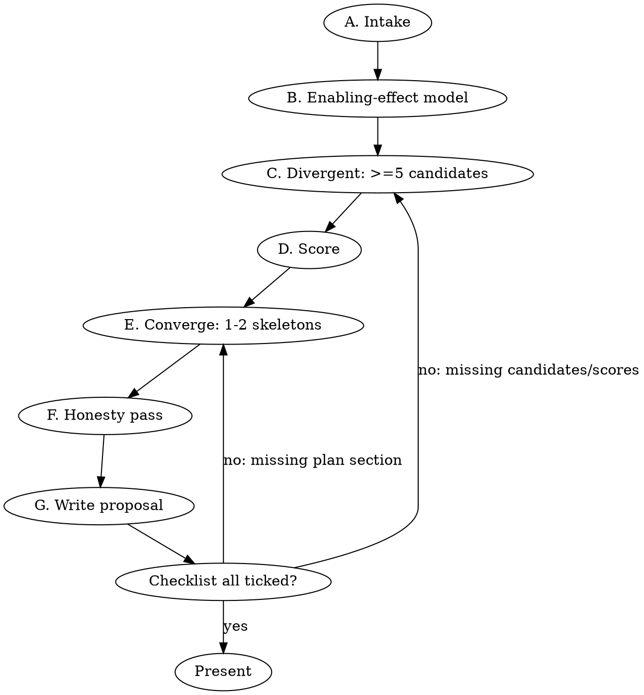

# Build Around an Item (Last Epoch 1.5.x)

## Overview

Turn "I found this item" into a build proposal the player can take into the game and test. The proposal must be grounded in data and still creative.

**Core principle:** first work out what the item actually does: its coded effect and its throughput. Then diverge widely (at least 5 archetypes), converge on 1-2, and label every number with its confidence. Every claim traces to a query result or a knowledge page. Never claim a build is proven.

**Violating the letter of these steps is violating their spirit.** "I already know what this item does" is the most common way a proposal goes wrong.

## When to use

- The player names a unique, set, legendary, idol or exalted rare, or pastes its tooltip, and asks what to build.
- The player wants an unusual or off-meta build that "uses" a specific item.
- The player asks whether a drop is worth building around.

Do NOT use for:
- Auditing an existing build. Use **le-build-audit**.
- A single mechanics question. Use **le-mechanics-reference**.
- A pure data lookup. Use **le-data-query**.

## Sibling skills (REQUIRED, do not re-derive their content)

| Need | Skill |
|---|---|
| Query recipes, tool argument shapes, empty-db fallbacks | **le-data-query** |
| Formula or rule lookup (layer order, ward decay, mana) | **le-mechanics-reference** |
| Damage path: buckets, tag matching, more vs increased, level DR | **REQUIRED SUB-SKILL:** **le-damage-reasoning** |
| Defense plan: resistances, armour/dodge/block/ward, endurance, EHP | **REQUIRED SUB-SKILL:** **le-defense-reasoning** |
| Post-draft self-check of the finished skeleton | **le-build-audit** |

## Tools

MCP server `le-data` (arguments are JSON objects; full shapes in **le-data-query** and `.claude/skills/README.md`):
- `version({})`, `schema({"table"?})`, `knowledge({"page"?})`
- `lookup({"name","kinds"?,"limit"?})`: resolves names (player abilities rank first). `search({"query","kinds"?,"limit"?})`: fuzzy text discovery only.
- `get({"kind","id","include_raw"?})`: main record plus children as separate top-level keys.
- `find_mods({"filters":{"property"?,"property_name"?,"tags_any"?,"tags_all"?,"include_untagged"?,"modifier_type"?,"source_kinds"?,"source_id"?,"min_value"?,"special_tag"?},"limit"?})`: filters are **nested**; never flat.
- `skill_tree({"ability_id": "<id>"})`, `passive_tree({"class_id": "<class>"})`, `sql({"query","params"?,"limit"?})` (read-only).

Without MCP, run `yarn mcp:call <tool> '<json args>'` from the repo root in Bash, for example `yarn mcp:call lookup '{"name":"Culnivar"}'` or `yarn mcp:call find_mods '{"filters":{"property":18},"limit":10}'`. On Windows the call goes through `cmd.exe`: JSON containing `<`, `>`, `%`, `&` or `|` (all the Q-recipes below) must go on stdin (`yarn mcp:call sql <<'JSON' ... JSON`) or `@file.json`, otherwise it can be silently corrupted (see **le-data-query**). If a call rejects its arguments, read **le-data-query**; do not guess.

**Empty or stub database.** A db built with `LE_DB_ALLOW_STUBS=1` has empty tables, but `meta` is still filled. Read `game_version` and `data_version` from `meta` anyway.

If `SELECT count(*) FROM uniques` returns 0, fall back to the vendored JSON in `vendor/lastepochbuilder/research/data/game/`: `uniques.json`, `unique_effects.json`, `abilities.json`, `affixes.json`, `trees.json`, `tree_node_stats.json`, `items.json` and `blessings.json`.

- A JSON read counts as a "logged query" when you record it as `file` + record id + field (for example `uniques.json uniqueID 33 mods[2]`).
- Field names differ from the db: `uniqueID`, `modType`, `affixId`, `canRollOn`, `tiers[].rolls`, `masteryRequirement`, `abilityName`, `playerAbilityID`.
- Say in the proposal which source you used.

Knowledge pages (read the Summary section of each before you rely on it):
- `knowledge/interactions/catalogue.md`: 117 tagged interactions, the creative fuel. Usage rules are in `knowledge/interactions/README.md`.
- `knowledge/interactions/unique-effects-index.md`: one row per unique, with tooltip and model column.
- `knowledge/mechanics/stat-model.md`: how every source reduces to `Stat` records.
- `knowledge/mechanics/` pages: damage, defenses, ailments, ward/sustain, speed/mana, minions, enemies.
- `knowledge/reference/` pages: classes and masteries, items, uniques/sets/legendary, idols and blessings, skills and trees, endgame systems.
- `docs/schema.md`: tables, views and example queries. `docs/data-sources/enums.md`: tag bits, SP ids, 5000+ node properties.

## Procedure

Work through the phases in order. Write the intermediate results down; the proposal template needs them.



### Phase A: Intake (steps 1-6)

1. **Pin the data version.** Call `version({})` (or `SELECT key, value FROM meta`). Record `game_version` and `data_version`; they go on the Build card. Check that the db has rows. If not, use the vendored-JSON fallback and note the vendored `gameVersion` (1.5.0).
2. **Parse what the player gave you.**
   - A bare name: resolve it with `lookup({"name":"<name>","kinds":["unique"]})`; for typos fall back to `search({"query":"<name>","kinds":["unique"]})`.
   - A pasted tooltip: extract the name, item level, rarity, every affix line with its value, any tier markers (T1-T8), LP ("Legendary Potential"), WW ("Weaver's Will"), corrupted or sealed markers, and the class line ("Requires Mage").
   - A screenshot description: as for a pasted tooltip. Ask for any missing affix values only if they change the build; otherwise mark them as assumptions.
   - A rare or exalted item (not a unique): resolve each affix line to an `affix_id` with `search({"query":"<affix line>","kinds":["affix"]})`, then tier it against `mods` rows (`source_kind = 'affix_tier'`). Its "enabling effect" is then the best-in-slot combination, and the rest of the procedure still applies.
3. **Resolve the item and pull its mods.** Run `get({"kind":"unique","id":<uid>})` (returns `unique`, `mods`, `tooltips`, `subtypes`, `set`), or queries Q1-Q2 below. Record every mod with its property, tags, modifier type and roll range, and every tooltip line. Indirect lines (SP 98 PlayerProperty, SP 58 AbilityProperty) are pointers to coded effects. Record the PP or AP index (`tags`) and do not sum them as stats (`knowledge/mechanics/stat-model.md`, "Special properties").
4. **Read its model.** Find the row in `knowledge/interactions/unique-effects-index.md` (model column: PP/AP/C kinds). Read its `unique_effects.json` entry: the `effects[].formula`, `condition`, `trigger` and `confidence` fields. Then search `catalogue.md` for its uid and name. The code formula wins over the tooltip; record any D? flag.
5. **Split the value.**
   - *Enabling effect*: the line that changes a rule (a conversion, trigger, resource loop, cap change or skill rewrite).
   - *Stat stick*: the plain mods. Note which tag combination the stat stick wants. For example, Lightning|Spell (258) only helps skills that carry both tags.
   Keep both: a build can use the enabler with the stat stick wasted, but say so.
6. **Restrictions and slot.** Run Q3 to record:
   - slot and base (1H or 2H, off-hand, idol size);
   - level requirement of the unique and of the base (they can differ: quote both);
   - class requirement (`item_subtypes.class_requirement_names`);
   - primordial, set or WW status;
   - LP: whether it can become legendary, and which affixes roll on that base (Q10);
   - corruption: a corrupted item cannot become legendary (`knowledge/reference/uniques-sets-legendary.md`).
   Note what the slot forbids, for example a 2H weapon rules out shields and many uniques.

### Phase B: Enabling-effect model (steps 7-8)

7. **Write the rate equation.** For any resource, proc or stack the effect creates, write throughput per second in terms of build stats, using the D formula. Then compute it for a plausible endgame value (label it **U** unless every input is sourced). Examples:
   - a "convert X when full" effect yields at most the net X regeneration per second;
   - a proc gives event rate x chance x count, capped by its ICD (`knowledge/mechanics/speed-cooldowns-mana.md`, "6. Trigger frequency").
8. **Benchmark it.** Compare that throughput with a plain alternative: a T7/T8 affix or a common unique doing the same job (Q8 tier ranges). If the enabler loses badly to a plain affix, say so on the Build card. The build must then justify the item some other way, through its stat stick, its burst shape or a rule change.

### Phase C: Divergent phase (steps 9-14)

Generate **at least 5** candidate archetypes. Ask each question below and log the query you ran and what came back. A candidate that no query supports does not count.

9. **Skills carrying the boosted tags.** Run Q4 with the stat stick's tag mask, `(tags & mask) = mask`, restricted to player skills with a tree. Then run Q5 for who can use each skill (class, mastery and unlock level).
10. **Rule-changing nodes.** For every candidate skill, scan its tree for conversion, trigger, "no longer", "instead", "while out of" or "consume" nodes (Q6; `skill_tree({"ability_id":"<id>"})`). Also run the global scan Q7 for nodes that mention the item's resource or trigger. Record nodes as `<tree>:<node> Name`. Stat ids 5000 and up are skill-local (`docs/data-sources/enums.md`, section 3.3). Their real modifier type is in code, so treat their magnitude as **A** and their type as unknown.
11. **Catalogue chains.** Pick the tags that describe the enabling effect, using the tag set in `knowledge/interactions/README.md`. Read every catalogue entry that carries them. Then chain each one: converter + engine, engine + payoff. Look explicitly for at least one pairing that no catalogue entry names together. That is the novelty candidate.
12. **Stack partners.** Find other sources of the same property or PP index: `find_mods({"filters":{"property":<P>},"limit":50})`, or Q8 and Q9 for PP indices. Cover uniques, set bonuses, affixes, idol affixes (Q11) and blessings (Q12). Count how many rare uniques each candidate would need.
13. **Passive reach.** For each class that owns a candidate skill, find the passives that feed the property (Q13 or `passive_tree({"class_id":"<class>"})`). Note the mastery gating (`mastery_requirement`).
14. **Natural defense layer.** For each candidate, name the defense its class and mastery bring: ward (Mage, Acolyte), block and armour (Sentinel), dodge (Rogue), endurance, minions as meat. Note whether that layer conflicts with the item, for example "mana before health" never protects ward. For the layer rules, use **le-defense-reasoning**.

Archetype prompts, so you do not stop at the obvious one:
- direct self-cast;
- triggered or auto-cast ("directly" clauses exclude these; see the catalogue);
- minion, totem or companion (only Minion- or Totem-tagged stats transfer: the stat stick is often lost);
- channel or stance;
- the "use only the enabler" build;
- off-class via conversion or re-tagging;
- defensive-engine build, where the item is the defense and the damage comes from elsewhere.

### Phase D: Score (step 15)

15. **Score every candidate 1-5 on each axis** and show the table in the proposal.

| Axis | 1 | 3 | 5 |
|---|---|---|---|
| Damage ceiling plausibility | no scaling skill or the stat stick is wasted | one solid more-multiplier path | several independent more sources on a skill the stat stick fully matches |
| Defense feasibility | resistances or a layer cannot be capped or built in the free slots | capped resistances plus one strong layer | capped resistances plus two layers plus stun avoidance or immunity |
| Sustain | no recovery outside potions | one recovery source | recovery scales with the build's main stat |
| Gear accessibility | 3+ other chase uniques or a primordial needed | 1-2 other uniques | the item plus rares or exalted items only |
| Novelty | standard archetype that only incidentally uses the item | known catalogue chain applied | pairing not named together in any catalogue entry or skill text |

**Gate:** drop any candidate with Damage < 2 or Defense < 2, unless the player asked for a meme build. Total = sum. Break ties toward Gear accessibility. Never call a score "tier" or "meta".

### Phase E: Convergent phase (steps 16-26)

Pick the top 1-2 candidates. For each, fill in the skeleton:

16. **Class and mastery**, with the mastery's base bonuses (`knowledge/reference/classes-and-masteries.md`, "Masteries, mastery skills and base mastery bonuses").
17. **Five skills**, each with:
    - role (main, mobility, buff, defense, utility or enabler);
    - the key tree nodes by `<tree>:<node> Name` and points;
    - one line on why each node is there.
    The total must respect the per-skill point budget (20 natural levels plus +levels; see `knowledge/reference/skills-and-trees.md`).
18. **Passive priorities**, by node name and tree id (`mg-1:14 Wisdom`), ordered and marked mastery-gated where they are. Respect the passive point budget (`knowledge/reference/classes-and-masteries.md`, "Passive points and tree structure").
19. **Gear by slot:**
    - the item itself;
    - every other unique, with its uid;
    - for rare or exalted slots, the required affixes by name and id with a tier target (T5 craftable, T6-T7 drop, T8 primordial);
    - the LP or legendary plan for the item (Q10);
    - which slot carries which resistance.
20. **Idols:** shapes and affixes by name and id (Q11), class restrictions, and the one-of-each rule for unique idols.
21. **Blessings:** one per timeline (Q12), normal vs Grand, chosen to close the defense or mana gaps.
22. **Damage path.** Apply **le-damage-reasoning**: the main skill's tags, added (x ADE) / increased / more per bucket, the crit or ailment path, penetration, and "vs dummy" vs "vs level-100 boss". Name every more-multiplier and its source id.
23. **Defense plan.** Apply **le-defense-reasoning**:
    - all seven resistances to 75% and where each comes from;
    - the primary layer (armour, dodge, block or ward) with its target number;
    - endurance and endurance threshold;
    - stun and freeze avoidance;
    - DoT handling;
    - sustain.
    Say which layers do not protect which pool.
24. **Mana plan:** cost per second vs regen, mana before health (and whether it conflicts), negative-mana behaviour (`knowledge/mechanics/ward-health-sustain.md`, section "6. Mana"), and how the enabling effect changes it.
25. **Leveling to endgame:**
    - which skills and gear carry levels 1 to the item's level requirement;
    - when to switch;
    - which uniques are campaign-reachable and which are endgame chase;
    - which timeline or dungeon unlocks matter (`knowledge/reference/endgame-systems.md`).
26. **What to test first.** Write 5-8 checks. Each must be observable in game (character sheet value, combat log, ward bar, dummy DPS, buff icon) and must state the expected result and what failure means. Order them so the cheapest test of the riskiest assumption comes first.

### Phase F: Honesty pass (steps 27-30)

27. **Label every number** D / A / G / X / U, from the source it came from (`knowledge/README.md`, "Confidence legend"). Values you computed yourself inherit the weakest input label. Illustrative inputs are **U**.
28. **Flag the uncertainty.**
    - Every skill-tree node whose stat property is 5000+ or display-only (`modifier_type` NULL) makes the damage uncertain, because its type comes from code, not the tooltip. List these nodes.
    - Every D? effect.
    - Every "directly" clause on a triggered path.
29. **Anti-synergy sweep.** Read every catalogue entry tagged `anti-synergy` whose other tags overlap the plan. Run Q14 over the planned uniques for "cannot", "no ward", "do not" and "less" clauses. Check:
    - immunities that block self-ailments;
    - "no ward gain" sources;
    - Rage forms (Druid transforms replace mana);
    - the one-primordial limit;
    - the one-of-each unique idol rule;
    - minion snapshot and transfer rules;
    - "directly" exclusions.
30. **Assumptions and failure modes.** List each assumption, then what would make the build fail and the in-game check that would show it.

### Phase G: Write the proposal (step 31)

31. Fill `templates/proposal.md` exactly: every section, in order, with the Build card on top and the Data citations table at the bottom. Then run **le-build-audit** on the skeleton if it is available, and fix what it finds.

Worked example of the whole procedure, with real data values: `examples/culnivars-claim.md`.

## Query cookbook

These run through `sql({"query": "...", "params": [...]})`. `?` marks a positional parameter; ids compared after `CAST(? AS TEXT)` must be passed as JSON **strings** (`"33"`): a JSON number binds as a real and casts to `'33.0'`, which matches nothing. The `<!-- params: -->` comment above each recipe gives example values (Culnivar's Claim, uid 33, as in `examples/culnivars-claim.md`). From the CLI, use stdin because the SQL contains `<`, `>`, `%` or `|`:

```bash
yarn mcp:call sql <<'JSON'
{"query": "SELECT unique_id, name FROM v_unique_summary WHERE name LIKE '%' || ? || '%'", "params": ["Culnivar"]}
JSON
```

Q1. Resolve a unique by name:
<!-- params: ["Culnivar"] -->
```sql
SELECT unique_id, name, base_type, sub_type, level_requirement, set_name, mods_text, tooltip_text
FROM v_unique_summary
WHERE name LIKE '%' || ? || '%';
```

Q2. Its stat lines, with indirect properties resolved:
<!-- params: ["33"] -->
```sql
SELECT source_ord, sub_ord, property, property_name, tags, tag_names, modifier_name, value_min, value_max, hidden
FROM v_mods_named
WHERE source_kind = 'unique_mod' AND source_id = CAST(? AS TEXT)
ORDER BY source_ord, sub_ord;
```

Q3. Slot, base, restrictions and legendary fields:
<!-- params: [33] -->
```sql
SELECT u.unique_id, u.name, u.level_requirement, u.is_primordial, u.is_set_item, u.is_legendary_capable,
       u.effective_level_for_lp, u.can_drop_randomly, bt.name AS slot, bt.category,
       st.name AS base_item, st.level_requirement AS base_level, st.class_requirement_names
FROM uniques u
JOIN item_base_types bt ON bt.base_type_id = u.base_type_id
JOIN unique_subtypes us ON us.unique_id = u.unique_id
JOIN item_subtypes st ON st.base_type_id = us.base_type_id AND st.sub_type_id = us.sub_type_id
WHERE u.unique_id = ?;
```

Q4. Player skills carrying every bit of a tag mask (for example 258 = Lightning|Spell):
<!-- params: [258, 258] -->
```sql
SELECT ability_id, name, tag_names, mana_cost, channel_cost, channelled, max_charges, charges_gained_per_second
FROM abilities
WHERE is_player_ability = 1 AND has_skill_tree = 1 AND (tags & ?) = ?
ORDER BY mana_cost;
```

Q5. Who can use a skill, and from when:
<!-- params: ["lb23il"] -->
```sql
SELECT c.name AS class, coalesce(ms.name, 'base class') AS mastery, ca.kind, ca.level
FROM class_abilities ca
JOIN classes c ON c.class_id = ca.class_id
LEFT JOIN masteries ms ON ms.class_id = ca.class_id AND ms.mastery_index = ca.mastery_index
WHERE ca.ability_id = ?;
```

Q6. Rule-changing nodes in one skill tree:
<!-- params: ["lb23il"] -->
```sql
SELECT tree_id || ':' || node_id AS node, name, max_points, requires, description, stats_text
FROM v_skill_node_summary
WHERE tree_kind = 'skill' AND ability_id = ?
  AND (description LIKE '%convert%' OR description LIKE '%instead%' OR description LIKE '%no longer%'
       OR description LIKE '%chance to cast%' OR description LIKE '%while out of%' OR description LIKE '%consum%')
ORDER BY node_id;
```

Q7. Nodes in any skill tree that mention the item's resource or trigger word:
<!-- params: ["mana"] -->
```sql
SELECT tree_name, tree_id || ':' || node_id AS node, name, description
FROM v_skill_node_summary
WHERE tree_kind = 'skill' AND description LIKE '%' || ? || '%'
ORDER BY tree_name, node_id
LIMIT 80;
```

Q8. Every source of one stat property, strongest first (stack partners and benchmarks):
<!-- params: [18] -->
```sql
SELECT source_kind, source_id, source_name, tier, property_name, tag_names, modifier_name, value_min, value_max
FROM v_mods_named
WHERE property = ? AND source_kind IN ('unique_mod', 'set_bonus', 'affix_tier', 'blessing', 'passive_node', 'skill_node')
ORDER BY value_max DESC
LIMIT 50;
```

Q9. Every source of one PlayerProperty (SP 98, `tags` = PP index):
<!-- params: [69] -->
```sql
SELECT m.source_kind, m.source_id, m.source_name, pp.name AS player_property, m.value_min, m.value_max
FROM v_mods_named m
JOIN player_properties pp ON pp.idx = m.tags
WHERE m.property = 98 AND m.tags = ?;
```

Q10. Affixes that roll on the item's base type (LP and legendary plan, plus the rare slots):
<!-- params: [8] -->
```sql
SELECT a.affix_id, a.name, a.affix_type_name, a.special_affix_type, a.tier_count, a.stats_text
FROM v_affix_summary a
JOIN affix_can_roll_on r ON r.affix_id = a.affix_id
WHERE r.base_type_id = ? AND a.rolls_on = 0
ORDER BY a.special_affix_type, a.affix_type_name, a.name;
```

Q10b. Tier table of one affix (tier targets):
<!-- params: ["330"] -->
```sql
SELECT m.tier, t.required_level, m.source_ord, m.property_name, m.value_min, m.value_max
FROM mods m
LEFT JOIN affix_tiers t ON t.affix_id = CAST(m.source_id AS INTEGER) AND t.tier = m.tier
WHERE m.source_kind = 'affix_tier' AND m.source_id = CAST(? AS TEXT)
ORDER BY m.tier, m.source_ord;
```

Q11. Idol affixes for a property, with class and shape:
<!-- params: [18] -->
```sql
SELECT a.affix_id, a.name, a.class_names, a.stats_text, a.rolls_on_text
FROM v_affix_summary a
WHERE a.rolls_on = 1
  AND a.affix_id IN (SELECT CAST(source_id AS INTEGER) FROM mods WHERE source_kind = 'affix_tier' AND property = ?)
ORDER BY a.name;
```

Q12. Blessings for a property, by timeline:
<!-- params: [8] -->
```sql
SELECT timeline_name, name, is_grand, slot_kind, property_name, tag_names, modifier_name, value_min, value_max
FROM v_blessings
WHERE property = ?
ORDER BY timeline_id, is_grand, name;
```

Q13. Class passives that mention a stat (per class and mastery):
<!-- params: ["ward", "ward"] -->
```sql
SELECT c.name AS class, s.mastery, s.tree_id || ':' || s.node_id AS node, s.name, s.max_points,
       s.mastery_requirement, s.stats_text
FROM v_skill_node_summary s
JOIN trees t ON t.tree_id = s.tree_id
JOIN classes c ON c.class_id = t.class_id
WHERE s.tree_kind = 'class' AND (s.stats_text LIKE '%' || ? || '%' OR s.description LIKE '%' || ? || '%')
ORDER BY c.name, s.mastery, s.mastery_requirement;
```

Q14. Drawback clauses on the planned uniques (anti-synergy sweep; pass a JSON array of ids):
<!-- params: ["[33, 368, 440]"] -->
```sql
SELECT unique_id, name, tooltip_text
FROM v_unique_summary
WHERE unique_id IN (SELECT value FROM json_each(?))
  AND (tooltip_text LIKE '%cannot%' OR tooltip_text LIKE '%no ward%' OR tooltip_text LIKE '%do not%'
       OR tooltip_text LIKE '%less%' OR tooltip_text LIKE '%lose%');
```

Q15. Abilities that a unique triggers or levels (Melvern's Writ, uid 108, has relations; Culnivar's Claim has none):
<!-- params: ["108"] -->
```sql
SELECT r.relation, r.target_kind, r.target_id, a.name, r.value
FROM relations r
LEFT JOIN abilities a ON a.ability_id = r.target_id
WHERE r.source_kind = 'unique' AND r.source_id = CAST(? AS TEXT);
```

## Honesty rules

- Every number carries a label: D, A, G, X or U. A computed number takes the weakest label among its inputs. No unlabelled numbers in the proposal. Ids and indices (uid 33, PP 664, `lb23il:28`, affix 330) are identifiers, not quantities, and need no label.
- Write "vs dummy" or "vs level-N monster" next to any damage figure. Level damage reduction alone is x0.13 at level 100 (`knowledge/mechanics/damage-pipeline.md`).
- Skill-tree mutators (stat ids 5000 and up, display-only node stats) are coded per skill. Name each one you rely on and mark its contribution "type unknown (A magnitude)".
- Never write "meta", "best", "proven", "top-tier" or "S-tier". Write "plausible", "to test", "should".
- Compare the plan against every overlapping catalogue entry, anti-synergies first. List the entries checked by heading.
- List assumptions and failure modes explicitly, even when they feel obvious.
- If the enabling effect loses to a plain affix (Phase B), say so on the Build card.

## Red flags: stop and go back

| Thought | Reality |
|---|---|
| "I know what this item does." | Tooltips lie or round. Read `unique_effects.json` `formula` and `condition` (step 4). |
| "One build is obvious, skip the other four." | The obvious build is usually the common one. Five candidates is the minimum (step 9). |
| "The stat stick applies to my minions or totems." | Only Minion- or Totem-tagged stats transfer (`knowledge/mechanics/minions.md`). |
| "The trigger will feed this 'when you directly cast' effect." | It will not: triggered casts are not direct (catalogue). |
| "Big burst numbers mean big sustained value." | Write the rate equation (step 7). Bursts decay; throughput is what counts. |
| "Defense: just get resistances." | Name the layer, the number and the pool it protects (step 23). |
| "Numbers are approximate anyway, no labels needed." | Unlabelled numbers are the main failure. Label everything (step 27). |
| "The db is empty, so I will go from memory." | Use the vendored JSON fallback and cite it. |

## Common mistakes

- Summing an SP 98 or SP 58 value as a damage stat. It is an index into a coded effect.
- Matching a stat by any shared tag. The rule is subset: every tag on the mod must be on the skill.
- Planning two "damage taken as" passives, two primordials, two copies of a unique idol, or a Druid form with a mana-based unique.
- Forgetting that the item's slot removes options: a 2H weapon means no shield, and a 1H sceptre leaves the off-hand free.
- Building on a D? effect without making it test #1.
- Using a corrupted copy of the item in the legendary plan.

## Final checklist (tick every item before presenting)

- [ ] `game_version` / `data_version` recorded; data source (db or vendored JSON) stated
- [ ] Item resolved by id; all mods listed with property, tags, type, range; tooltip lines quoted
- [ ] Coded effect read (`unique_effects.json` formula/condition/confidence) and catalogue searched by uid and name
- [ ] Enabling effect vs stat stick split stated; stat-stick tag mask named
- [ ] Slot, base, both level requirements, class requirement, LP/WW/primordial/set status recorded
- [ ] Rate equation written and benchmarked against a plain affix or unique
- [ ] At least 5 candidates, each backed by a logged query; at least 1 marked as the novelty pairing
- [ ] Scoring table with all 5 axes; gate applied
- [ ] 1-2 skeletons with class/mastery, 5 skills with `<tree>:<node>` nodes, passives by node, gear by slot with affix ids and tier targets, idols, blessings
- [ ] Damage path done with le-damage-reasoning ("vs dummy" / "vs level-N" stated)
- [ ] Defense plan done with le-defense-reasoning: 7 resistances sourced, layer targets, endurance, stun, DoT, sustain
- [ ] Mana plan, including the enabling effect's effect on mana
- [ ] Leveling-to-endgame transition
- [ ] 5-8 in-game tests, each with observable, expected value and failure meaning; riskiest first
- [ ] Every number labelled D/A/G/X/U; mutator-dependent and D? items listed
- [ ] Anti-synergy sweep done (catalogue headings listed, Q14 run)
- [ ] Assumptions and failure modes listed
- [ ] No "meta"/"proven" language
- [ ] Proposal follows `templates/proposal.md`, with the Build card at the top and Data citations at the bottom
